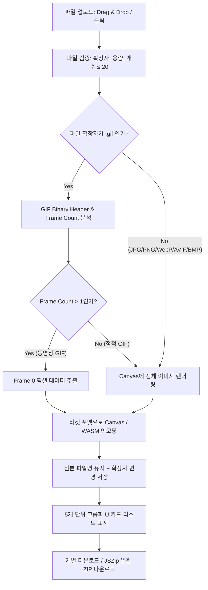

# 업무용 프로그램 개발 Design Doc (v1.1) — convertimage
*Universal Business Utility Program Design Document v1.1*
***작성 기준: convertimage v1.4 (Next.js 15 + Tailwind CSS v4 + Canvas/WASM + Firebase + Vercel)***
*참조 표준: AEa26[KHS](aGames)미니게임_Design_Doc_1_1.md 및 업무용 프로그램 개발 표준 세부 기획서 1.4*

--------------------------------------------------------------------------------

#### **0. 이 문서의 사용법**
##### 0.1 문서의 역할과 목적
| 문서 | 무엇을 정하나 | 주요 대상 |
| ------ | ------ | ------ |
| 업무용 프로그램 개발 표준 세부 기획서_1_4.md | **전체 시스템 세부 규격** : 프로젝트 목표, 아키텍처, 3개 프레임 UX, 공통 정책, i18n, 배포 파이프라인 | 표준 기획 문서 |
| **이 Design Doc (v1.1)** | **`convertimage`만의 세부 비주얼/UX/엔진 설계** : '케데헌' 비주얼 바이브, 6초 인트로 Omni 동영상 프롬프트, Canvas/GIF 프레임 변환 로직, UI Fixtures, 에셋 프롬프트, 다국어 사전, Cursor 에이전트 프롬프트 | AI 코딩 Agent (Cursor) & 개발자 |

##### 0.2 작성 및 코딩 규칙
* 수치는 **숫자로 명확하게** 기재한다 (예: "1회 최대 20개 파일", "5개 단위 그룹화", "6초 인트로").
* 프로그램 데이터의 **모든 ID, 변수명, 함수명, 파일명, DB 필드는 100% 영문(English)**으로 작성한다.
* 화면에 표시되는 사용자 UX 텍스트는 **한국어(Default), English, Japanese** 3개 언어 표로 구성한다.
* AI 에이전트(Cursor)는 이 문서의 수치와 구조를 1:1로 코드로 구현한다.

##### 0.3 목차
1. 프로그램 개요 · 2. 핵심 변환 루프 및 특수 판별 로직 · 3. 화면 흐름 및 반응형 UX 레이아웃 · 4. 이미지 변환 엔진 시스템 · 5. UI Fixtures & Glassmorphism 컨테이너 · 6. 파일 업로드 및 관리 시스템 · 7. '케데헌' 비주얼 스타일 & 아트 디렉션 · 8. GIF 1프레임/다중프레임 판별 명세 · 9. 반응형 3개 프레임 세부 명세 · 10. 사용 통계 및 히스토리 · 11. 인터랙션 & 캔버스 좌표계 · 12. 조작 및 입력 인터랙션 · 13. 에셋 마스터 목록 & 생성 프롬프트 · 14. UI 애니메이션/Glow 요청서 · 15. 6초 인트로 Omni 동영상 생성 프롬프트 · 16. 사운드 & UX SFX · 17. 다국어 (i18n) 사전 · 18. 계정 & Firestore 데이터 구조 · 19. 기술 아키텍처 및 폴더 구조 · 20. 성능 예산 · 21. QA 테스트 계획 · 22. GitHub & Vercel 배포 · 23. 개발 일정 및 마일스톤 · 부록 A. AI 코딩 에이전트 선정 결과 (Cursor) · 부록 B. 개발 및 디버깅 가이드

--------------------------------------------------------------------------------

#### **1. 프로그램 개요 (Program Overview)**

| 항목 | 내용 상세 |
| ------ | ------ |
| **프로그램명** | convertimage / 컨버트이미지 (로고: `convertimage`) |
| **영문 ID** | `convertimage` |
| **한 줄 소개** | 미니게임 그래픽 자산을 손실 없이 빠르고 스타일리시하게 변환하는 웹 포맷 컨버터 |
| **핵심 재미/가치** | ① 6개 주요 이미지 포맷(JPG, PNG, WebP, AVIF, GIF, BMP) 상호 변환<br>② 애니메이션 GIF에서 첫 프레임(Frame 0) 자동 추출 정적 변환<br>③ 최대 20개 파일 일괄 업로드 & 동일 원본 파일명 유지 일괄 다운로드<br>④ '케데헌' 다크 판타지 네온 애니메이션 스타일의 스타일리시한 UX |
| **타겟 사용자** | 미니게임 개발자, 그래픽 디자이너, 2D/3D 게임 에셋 크리에이터 |
| **플랫폼** | 웹 PWA / Responsive Web (데스크톱, 모바일 세로, 모바일 가로 3개 프레임 초속 전환) |
| **핵심 기술 스택** | **Next.js 15+ (React 19) + Tailwind CSS v4 + Framer Motion + HTML5 Canvas API + Firebase Auth/Firestore + Vercel** |
| **개발 에이전트** | **Cursor (AI-Native IDE)** |

--------------------------------------------------------------------------------

#### **2. 핵심 변환 루프 및 특수 판별 로직 (Core Conversion Loop & Rules)**



##### **핵심 변환 규칙 수치**
| 규칙 항목 | 수치 및 동작 명세 |
| ------ | ------ |
| **지원 입출력 포맷** | JPG, PNG, WebP, AVIF, GIF, BMP (상호 100% 변환) |
| **동시 업로드 제한** | 1회 최소 1개 ~ **최대 20개** |
| **리스트 표현 방식** | 업로드 파일 카드가 5개 단위로 페이지네이션/슬라이드 그룹화되어 표시 |
| **파일명 유지 규칙** | 변환 후 파일명 = 원본 파일명 (확장자만 타겟 포맷으로 자동 교체) |
| **다운로드 위치** | 원본 업로드 디렉토리 / 브라우저 기본 다운로드 위치와 동일 유지 |
| **GIF 처리 규칙** | Single Frame -> 정적 변환, Multi Frame -> Frame 0(첫 프레임) 추출 변환 |

--------------------------------------------------------------------------------

#### **3. 화면 흐름 및 반응형 UX 레이아웃 (Screen Flow & Layout)**

##### **3.1 메인 UX 화면 흐름**
1. **Intro Screen (`/intro`)** : 6초 '케데헌' 스타일 애니메이션 비디오 자동 재생 (Skip 버튼 및 네온 Sound 토글 포함).
2. **Login Selection Screen (`/auth`)** : 4가지 인증 수단 선택 (`[Google 로그인]`, `[이메일 로그인]`, `[휴대폰 로그인]`, `[회원가입]`, `[계정 없이 사용(Guest)]`).
3. **Login / Register Screen (`/auth/login`)** : 인증 처리 화면.
4. **Main Converter Screen (`/`)** : **`[PNG로 변환 (Convert to PNG)]` 탭이 최우선 기본 활성화**.

##### **3.2 반응형 3개 프레임 레이아웃 규격**

| 프레임 구분 | 뷰포트 조건 | 레이아웃 구성 | UX 요소 및 동작 |
| ------ | ------ | ------ | ------ |
| **Desktop** | `width >= 1024px` | **Left Sidebar + Top/Center Tab** | • 좌측 사이드바(너비 280px): 최근 변환 기록, Quick Config, i18n 언어 스위처<br>• 상단/중앙: 변환 타겟 포맷 탭 (`PNG` 최우선) + DropZone + 5개 단위 리스트<br>• 우측 상단: `[마이페이지] [로그아웃]` |
| **Mobile Portrait** | `width < 1024px` & Portrait | **Top Header + Bottom Navigation Bar** | • 상단 헤더: `convertimage` 네온 로고 + 언어 선택 스위처<br>• 하단 네비게이션(높이 64px): `[변환 홈] [히스토리] [마이페이지]`<br>• 터치 친화적 콤팩트 DropZone |
| **Mobile Landscape** | `width < 1024px` & Landscape | **Top Header (Compact) + Bottom Navigation Bar** | • 상단 헤더(슬림 높이 48px): 한 줄 로고 및 포맷 퀵 셀렉트<br>• 하단 네비게이션(높이 56px)<br>• 수평 공간을 활용한 2열 변환 카드 그리드 레이아웃 |

--------------------------------------------------------------------------------

#### **4. 이미지 변환 엔진 시스템 (Image Engine System)**

##### **4.1 클라이언트 사이드 변환 파이프라인 (Canvas & WASM)**
* **기본 변환 (PNG, JPG, WebP, BMP)**:
  * HTML5 `HTMLCanvasElement` 및 `CanvasRenderingContext2D` 활용.
  * `canvas.toBlob(callback, mimeType, quality)`를 호출하여 브라우저 메모리 내 변환.
* **고급 포맷 변환 (AVIF)**:
  * Native 브라우저 `image/avif` 지원 시 Native Canvas API 사용.
  * 폴백(Fallback): `sharp-wasm` 또는 `libavif` WebAssembly 인코더 사용.
* **GIF 프레임 분석 및 추출 Engine**:
  * `gifuct-js` 라이브러리를 통해 GIF의 Raw Byte Array 패싱.
  * `parseGIF()` 및 `decompressFrames()`로 프레임 헤더 검사.
  * `frames.length === 1` -> 정적 이미지 Canvas 변환.
  * `frames.length > 1` -> `frames[0]`의 `patch` ImageData를 Canvas `putImageData()`로 복사 후 인코딩.

--------------------------------------------------------------------------------

#### **5. UI Fixtures & Glassmorphism 컨테이너 (UI Fixtures & Panels)**

'케데헌' 다크 판타지 애니메이션 스타일을 구현하기 위한 컨테이너 및 피스처 명세.

| UI 요소 | CSS / Tailwind 스펙 | 비주얼 인터랙션 |
| ------ | ------ | ------ |
| **Main Background** | `bg-[#0B0C10]` + `bg-gradient-to-br from-[#0B0C10] via-[#12131C] to-[#0B0C10]` | 오로라 및 포털 그래디언트 애니메이션 |
| **Glass Panel** | `bg-[#161824]/80` + `backdrop-blur-md` + `border border-[#00F0FF]/30` | 네온 글래스모피즘, 12px 반투명 블러 |
| **Drag & Drop Zone** | `border-2 border-dashed border-[#00F0FF]/40` + `rounded-2xl` | Drag Enter 시 `#FF0055` / `#00F0FF` 에너지 Glow Pulse 테두리 |
| **Neon Button** | `bg-gradient-to-r from-[#00F0FF] to-[#9D00FF]` + `shadow-[0_0_15px_rgba(0,240,255,0.5)]` | Hover 시 발광 강도 150% 증폭 및 3D Elevation |
| **Format Tab** | Active: `text-[#00F0FF]` + `border-b-2 border-[#00F0FF]` + `shadow-glow` | 탭 전환 시 딜레이 없는 초속 하이라이트 |

--------------------------------------------------------------------------------

#### **6. 파일 업로드 및 관리 시스템 (File Upload & List System)**

##### **6.1 업로드 및 리스트 스펙**
* **입력 방식**: Drag & Drop 영역 및 `<input type="file" multiple accept="image/*">` 동시 지원.
* **최대 파일 제한**: 1회 업로드 시 최대 **20개** 파일 제한. 20개 초과 시 alert toast 표시 (`최대 20개까지 일괄 업로드 가능합니다`).
* **5개 단위 리스트 표현**:
  * 업로드된 파일 카드가 1개씩 추가될 때, UI는 **5개 단위 슬라이딩 카러셀 또는 페이지네이션 뷰**로 자동 분할.
  * 예: 12개 업로드 시 -> [1~5 페이지] / [6~10 페이지] / [11~12 페이지] 탭 버튼 제공.
* **다운로드 시스템**:
  * 개별 파일: 카드 내 `[다운로드]` 버튼 클릭 시 해당 포맷 저장.
  * 일괄 파일: `[전체 다운로드]` 클릭 시 `JSZip` 모듈을 이용해 20개 변환 파일을 단일 ZIP으로 압축 다운로드.

--------------------------------------------------------------------------------

#### **7. '케데헌' 비주얼 스타일 & 아트 디렉션 (Visual Art Direction)**

캐릭터 일러스트 없이 '케데헌' 애니메이션 특유의 다크 판타지, 네온 튜브 라인, 글로우 효과를 UI 그래픽에 통합한다.

##### **STYLE BLOCK (프롬프트 공통)**
> `K-Demon Hunter animation vibe, dark obsidian fantasy style, vibrant neon cyan #00F0FF, vivid magenta #FF0055, electric purple #9D00FF glow accents, glowing neon line art icons, dark glassmorphism containers, clean UI assets, NO human characters, NO text.`

##### **컬러 팔레트 (Color Palette)**
* **Dark Obsidian (Base)**: `#0B0C10`, `#12131C`
* **Neon Cyan (Accent 1)**: `#00F0FF`
* **Vivid Magenta (Accent 2)**: `#FF0055`
* **Electric Purple (Accent 3)**: `#9D00FF`
* **Glow Text / Icon**: `#E0F7FA`, `#FFFFFF` with `drop-shadow-[0_0_10px_#00F0FF]`

--------------------------------------------------------------------------------

#### **8. GIF 1프레임/다중프레임 판별 명세 (GIF Detection Spec)**

```typescript
// GIF Frame Extraction Algorithm Specification
export async function processGifFile(file: File): Promise<ImageData> {
  const arrayBuffer = await file.arrayBuffer();
  const gif = parseGIF(arrayBuffer);
  const frames = decompressFrames(gif, true);
  
  if (frames.length === 0) {
    throw new Error("INVALID_GIF_FILE");
  }
  
  // Case A: Single Frame (Static GIF) or Case B: Multi-Frame (Animated GIF)
  // Both extract Frame 0 (the very first frame) for lossless conversion.
  const firstFrame = frames[0];
  const canvas = document.createElement("canvas");
  canvas.width = firstFrame.dims.width;
  canvas.height = firstFrame.dims.height;
  const ctx = canvas.getContext("2d")!;
  
  const imageData = ctx.createImageData(firstFrame.dims.width, firstFrame.dims.height);
  imageData.data.set(firstFrame.patch);
  return imageData;
}
```

--------------------------------------------------------------------------------

#### **9. 반응형 3개 프레임 세부 명세 (Responsive 3-Frame Details)**

##### **9.1 데스크톱 (`w >= 1024px`)**
* **좌측 사이드바 (Sidebar)**: 너비 280px 고정, 최근 변환 내역, `[Ko / En / Ja]` 언어 선택 스위처.
* **중앙 작업 영역**:
  * 상단: **`[PNG로 변환]` (Default Tab)** | `[JPG]` | `[WebP]` | `[AVIF]` | `[GIF]` | `[BMP]`
  * 중앙: 네온 Glow 테두리 Drag & Drop Zone.
  * 하단: 5개 단위 리스트 카드 (5, 10, 15, 20 분할 페이지).

##### **9.2 모바일 세로 (`w < 1024px`, Portrait)**
* **상단 헤더**: 로고 `convertimage` + 우측 언어 버튼.
* **하단 네비게이션 (Height 64px)**: `[Home (Convert)]` | `[History]` | `[My Page]`
* **터치 영역**: 터치 스와이프 지원 5개 카러셀 카드.

##### **9.3 모바일 가로 (`w < 1024px`, Landscape)**
* **상단 헤더 (Height 48px)**: 콤팩트 로고 및 변환 포맷 퀵 드롭다운.
* **하단 네비게이션 (Height 56px)**: 슬림 탭.
* **2열 카드 그리드**: 수평 공간을 활용한 2열 변환 카드 배치.

--------------------------------------------------------------------------------

#### **10. 사용 통계 및 히스토리 (Analytics & History)**

* **비회원 사용자**: 브라우저 `localStorage`에 최근 변환 10건 내역 저장 (파일 명, 변환 포맷, 일시).
* **로그인 사용자**: Firestore `users/{uid}/history` 컬렉션에 변환 통계 기록.
* **관리자 통계**: Firestore `stats/{yyyyMMdd}`에 일별 변환 횟수(포맷별) 자동 집계.

--------------------------------------------------------------------------------

#### **11. 인터랙션 & 캔버스 좌표계 (Interaction & Canvas Coordinates)**

* **HTML5 Canvas Coordinates**: `(0, 0)` Top-Left Origin.
* **Aspect Ratio Preservation**:
  * 원본 이미지의 너비(`width`)와 높이(`height`) 비율을 100% 유지.
  * 해상도 재조정 옵션 선택 시 비율 고정(Aspect Ratio Lock) 계산 적용.
  * Formula: `targetHeight = (targetWidth / originalWidth) * originalHeight`

--------------------------------------------------------------------------------

#### **12. 조작 및 입력 방식 (Controls & Input)**

| 동작 | 키보드 (Desktop) | 마우스 (Desktop) | 터치 (Mobile) |
| ------ | ------ | ------ | ------ |
| **파일 업로드** | `Ctrl + U` / `Cmd + U` | Drag & Drop / 클릭 | 파일 선택 / Gallery / 카메라 |
| **일괄 변환** | `Enter` / `Space` | `[일괄 변환]` 버튼 클릭 | `[일괄 변환]` 터치 |
| **전체 다운로드** | `Ctrl + D` / `Cmd + D` | `[전체 다운로드]` 클릭 | `[전체 다운로드]` 터치 |
| **언어 전환** | `Alt + L` | `[Ko / En / Ja]` 스위처 | `[Ko / En / Ja]` 터치 |

--------------------------------------------------------------------------------

#### **13. 에셋 마스터 목록 & 생성 프롬프트 (Asset Master List & Prompts)**

##### **13.1 에셋 마스터 목록**
| 분류 | 파일 경로 | 기술 규격 | 상태 |
| ------ | ------ | ------ | ------ |
| **인트로 비디오** | `public/assets/videos/intro_6s.mp4` | 1920x1080 (16:9), 6초, MP4 / WebM | 필수 |
| **데스크톱 아이콘** | `public/assets/brand/icons/desktop/icon-512.png` | 512x512 PNG, 네온 렌즈 | 완료 |
| **모바일 아이콘** | `public/assets/brand/icons/mobile/maskable-512.png` | 512x512 Maskable PNG | 완료 |
| **브랜드 로고** | `public/assets/brand/logo/logo_neon.svg` | SVG Vector, Cyan/Magenta Glow | 완료 |
| **포맷 아이콘 6종** | `public/assets/icons/format_{png,jpg,webp,avif,gif,bmp}.svg` | SVG Vector, 네온 튜브 라인 | 완료 |
| **UI State 3종** | `public/assets/brand/states/{empty,success,error}.png` | 960x540 PNG, Glassmorphism | 완료 |

--------------------------------------------------------------------------------

#### **14. UI 애니메이션/Glow 요청서 (UI FX Request)**

* **DropZone Glow Pulse**: `keyframes` 0% -> `box-shadow: 0 0 10px #00F0FF`, 50% -> `box-shadow: 0 0 25px #FF0055`, 100% -> `box-shadow: 0 0 10px #00F0FF`.
* **Button Click Ripple**: Framer Motion `whileTap={{ scale: 0.95 }}` 및 발광 에너지 파동 번짐.
* **Card Slide Motion**: 5개 단위 그룹 전환 시 `initial={{ opacity: 0, x: 20 }}` -> `animate={{ opacity: 1, x: 0 }}` (200ms).

--------------------------------------------------------------------------------

#### **15. 6초 인트로 Omni 동영상 생성 프롬프트 (6s Intro Omni Video Flow Prompt)**

**[MUST-HAVE REQUIREMENT]** `convertimage` 프로그램의 인트로 동영상(6초)을 AI 동영상 생성기(Omni / Sora / Runway / Pika)에서 즉시 생성할 수 있는 타임라인별 상세 생성 프롬프트입니다.

```text
================================================================================
CONVERTIMAGE INTRO VIDEO GENERATION PROMPT (6 SECONDS OMNI FLOW)
================================================================================

[GLOBAL STYLE SPECIFICATIONS]
- Duration: Exactly 6.0 seconds
- Aspect Ratio: 16:9 (1920x1080 Full HD)
- Frame Rate: 60 fps
- Style: K-Demon Hunter dark fantasy cyberpunk animation vibe, hyper-stylized 3D motion graphics, energetic neon lighting.
- Color Palette: Deep Obsidian Black (#0B0C10), Electric Cyan (#00F0FF), Vivid Magenta (#FF0055), Neon Purple (#9D00FF).
- Lighting: Volumetric neon rim lights, bloom lens flares, dark glass reflections, energetic particle sparks.

--------------------------------------------------------------------------------
[TIMELINE FLOW BREAKDOWN]

0.0s - 1.5s : [THE OBSIDIAN PORTAL RISES]
- Camera: Cinematic slow zoom-in toward the dark obsidian center.
- Visual: In a deep dark void with subtle dark grid lines, a mystical dark-glass geometric portal emerges. Glowing cyan and purple runic energy circles swirl around the portal border with soft volumetric haze.
- Motion: Energy particles assemble rapidly into the center frame.

1.5s - 3.5s : [MULTI-FORMAT ASSET INGESTION]
- Camera: Dynamic fast tracking shot.
- Visual: Holographic graphic asset cards labeled with glowing format badges (.JPG, .GIF, .WEBP, .BMP) float from all directions into the glowing energy portal.
- Motion: As the asset cards touch the portal boundary, they disintegrate into brilliant magenta and cyan energy pixels, sucked smoothly into the portal core.

3.5s - 5.0s : [THE LOSSLESS NEON TRANSFORMATION]
- Camera: Impact shockwave pulse zoom.
- Visual: The portal core flashes brightly with a vivid magenta shockwave. Crystal-clear, pristine PNG image assets emerge from the portal surrounded by electric purple glowing aura and sharp cyan outlines.
- Motion: The transformed assets spin elegantly, showing 100% lossless clarity and vibrant neon glow.

5.0s - 6.0s : [THE LOGO LOCKUP]
- Camera: Stable front alignment with subtle camera shake on impact.
- Visual: The electric neon text logo "convertimage" flashes forcefully in the center. Cyan and magenta dual-tone rim lighting illuminates the dark obsidian background. A crisp subtitle appears below: "Lossless Game Asset Converter".
- Motion: The text locks firmly into position as ambient neon particles drift gently into the dark background, holding clean focus until 6.0s.

--------------------------------------------------------------------------------
[FULL ONE-LINE OMNI PROMPT FOR GENERATOR]

"A hyper-stylized 6-second cinematic 3D motion graphic intro animation in K-Demon Hunter dark fantasy cyberpunk style. Deep obsidian black backdrop #0B0C10 with glowing cyan #00F0FF and magenta #FF0055 volumetric light rays. At 0-1.5s, a dark glass energy portal emerges with swirling runic neon circles. At 1.5-3.5s, holographic image cards with .JPG .GIF .WEBP badges dissolve into energetic light particles into the portal. At 3.5-5.0s, a magenta pulse explodes and pristine crystal-clear PNG assets emerge with purple glowing aura. At 5.0-6.0s, the energetic neon text logo 'convertimage' snaps firmly into center focus with electric rim lighting and drifting neon sparks. 60fps, 16:9, hyper-detailed, octane render style, NO text except 'convertimage'."

[NEGATIVE PROMPT]
"blurry, low resolution, cheap 2D, ugly characters, cartoon animals, noisy background, realistic human faces, watermarks, frame drop, laggy motion, oversaturated white, muddy colors."
================================================================================
```

--------------------------------------------------------------------------------

#### **16. 사운드 & UX SFX (Audio & UI Sound Effects)**

* **Intro Video Audio**: 6초 인트로 영상 내 사이버 SFX (포털 에너지 라이징 -> 임팩트 펄스 -> 로고 스냅).
* **UI Web Audio SFX**:
  * File Drop: `synthDrop.play()` (880Hz 짧은 비프).
  * Conversion Success: `synthSuccess.play()` (C-E-G 승리 음계 합성).
  * Download Click: `synthDownload.play()` (440Hz -> 880Hz 상승음).

--------------------------------------------------------------------------------

#### **17. 다국어 (i18n) 사전 (Localization Strings Table)**

| Resource Key | 한국어 (`ko`, Default) | English (`en`) | Japanese (`ja`) |
| ------ | ------ | ------ | ------ |
| `app_title` | 컨버트이미지 | convertimage | コンバートイメージ |
| `tab_png` | PNG로 변환 | Convert to PNG | PNGに変換 |
| `tab_jpg` | JPG로 변환 | Convert to JPG | JPGに変換 |
| `tab_webp` | WebP로 변환 | Convert to WebP | WebPに変換 |
| `tab_avif` | AVIF로 변환 | Convert to AVIF | AVIFに変換 |
| `tab_gif` | GIF로 변환 | Convert to GIF | GIF에変換 |
| `tab_bmp` | BMP로 변환 | Convert to BMP | BMPに変換 |
| `dropzone_title` | 이미지 파일을 드래그하거나 선택하세요 | Drag & drop image files or click to upload | 画像ファイルをドラッグ＆ドロップまたは選択 |
| `dropzone_sub` | 최대 20개 파일 일괄 업로드 지원 (JPG, PNG, WebP, AVIF, GIF, BMP) | Max 20 files supported (JPG, PNG, WebP, AVIF, GIF, BMP) | 최대20個のファイル一括サポート |
| `btn_convert_all` | 일괄 변환하기 | Convert All | 一括変換 |
| `btn_download_all` | 전체 다운로드 (ZIP) | Download All (ZIP) | 一括ダウンロード (ZIP) |
| `msg_gif_detected` | 애니메이션 GIF 감지: 첫 번째 프레임을 추출하여 변환합니다 | Animated GIF detected: Extracting Frame 0 for conversion | アニメーションGIF検出: 最初のフレームを抽出して変換 |
| `msg_success` | 변환이 완료되었습니다! | Conversion completed successfully! | 変換が完了しました！ |
| `msg_max_limit` | 한 번에 최대 20개까지만 업로드 가능합니다 | Maximum 20 files allowed at once | 一度に最大20個までアップロード可能です |

--------------------------------------------------------------------------------

#### **18. 계정 & Firestore 데이터 구조 (Account & Firestore Schema)**

##### **Firestore JSON Schema**
```json
{
  "users": {
    "{uid}": {
      "uid": "string",
      "email": "string",
      "displayName": "string",
      "preferredLanguage": "ko | en | ja",
      "preferredFormat": "png",
      "createdAt": "timestamp",
      "updatedAt": "timestamp"
    }
  },
  "history": {
    "{historyId}": {
      "uid": "string",
      "originalName": "hero_sprite.gif",
      "convertedName": "hero_sprite.png",
      "fromFormat": "gif",
      "toFormat": "png",
      "isAnimatedGif": true,
      "extractedFrame": 0,
      "fileSize": 1048576,
      "convertedAt": "timestamp"
    }
  }
}
```

--------------------------------------------------------------------------------

#### **19. 기술 아키텍처 및 폴더 구조 (Technical Architecture)**

```text
convertimage/
├── public/
│   ├── assets/
│   │   ├── brand/
│   │   │   ├── icons/ (desktop, mobile)
│   │   │   ├── logo/
│   │   │   └── states/
│   │   └── videos/
│   │       └── intro_6s.mp4
│   ├── favicon.ico
│   └── manifest.json
├── src/
│   ├── app/
│   │   ├── [locale]/
│   │   │   ├── layout.tsx
│   │   │   ├── page.tsx (Converter Main)
│   │   │   ├── auth/page.tsx
│   │   │   └── mypage/page.tsx
│   │   └── api/
│   ├── components/
│   │   ├── common/ (NeonButton, GlassContainer, Header, Sidebar, BottomNav)
│   │   ├── converter/ (DropZone, FormatTabs, FileList, FileCard, Pagination)
│   │   └── intro/ (IntroVideoModal)
│   ├── hooks/
│   │   ├── useImageConverter.ts
│   │   ├── useGifParser.ts
│   │   ├── useResponsiveLayout.ts
│   │   └── useI18n.ts
│   ├── lib/
│   │   ├── firebase.ts
│   │   ├── canvasEngine.ts
│   │   └── i18n/ (ko.json, en.json, ja.json)
│   └── types/
│       └── index.ts
├── tailwind.config.ts
├── package.json
└── next.config.mjs
```

--------------------------------------------------------------------------------

#### **20. 성능 예산 (Performance Budget)**

| 측정 항목 | 목표 기준치 | 최적화 기법 |
| ------ | ------ | ------ |
| **First Contentful Paint (FCP)** | 1.0초 이하 | Next.js Server Components & Font Optimization |
| **변환 처리 속도 (1개 파일)** | 100ms 이하 | HTML5 OffscreenCanvas & Web Worker 분리 |
| **20개 일괄 변환 속도** | 1.5초 이하 | Parallel Canvas rendering & JSZip async compression |
| **JS 번들 용량** | 250KB 이하 (Gzip) | Dynamic Import (gifuct-js, JSZip) |
| **반응형 프레임 전환 속도** | 0ms (즉시 전환) | Pure CSS Media Queries & React Tailwind Layout |

--------------------------------------------------------------------------------

#### **21. QA 테스트 계획 (Test Plan)**

| 테스트 항목 | 테스트 방법 | 합격 기준 |
| ------ | ------ | ------ |
| **GIF 프레임 추출 테스트** | 1개 프레임 GIF 및 50개 프레임 애니메이션 GIF 업로드 | Frame 0 픽셀이 오차 없이 PNG/JPG로 변환 |
| **20개 일괄 변환 테스트** | 20개 다양한 확장자(JPG, WebP, GIF 등) 동시에 드롭 | 20개 모두 변환 완료 및 ZIP 압축 다운로드 정상 작동 |
| **반응형 3개 프레임 테스트** | Chrome DevTools 화면 리사이즈 (Desktop, Portrait, Landscape) | 레이아웃 찌그러짐 없이 0초 즉시 반응 |
| **i18n 언어 전환 테스트** | `Ko`, `En`, `Ja` 버튼 클릭 | 모든 버튼, 메뉴, 메세지 100% 해당 언어로 교체 |
| **파일명 유지 테스트** | `my_game_character.webp` 업로드 후 PNG 변환 | 저장 파일명이 `my_game_character.png`로 정확히 일치 |

--------------------------------------------------------------------------------

#### **22. GitHub & Vercel 배포 (Deploy & Operations)**

* **버전 관리**: GitHub Public/Private Repository (`convertimage`).
* **CI/CD Pipeline**: GitHub `main` 브랜치 `git push` 시 Vercel Webhook 트리거되어 자동 빌드 및 배포.
* **환경 변수**: Firebase Config Key (`NEXT_PUBLIC_FIREBASE_API_KEY` 등)는 Vercel Project Environment Variables에 등록.

--------------------------------------------------------------------------------

#### **23. 개발 일정 및 마일스톤 (Milestones)**

| 마일스톤 | 핵심 개발 과제 | 주요 산출물 |
| ------ | ------ | ------ |
| **M0: Project Setup** | Next.js App Router, Tailwind CSS v4 '케데헌' 테마 세팅 | 기본 골격 빌드 |
| **M1: Conversion Engine** | HTML5 Canvas & GIF Frame 0 추출 훅 구현 | 포맷 변환 핵심 엔진 |
| **M2: UI/UX & Responsive** | 3개 프레임 레이아웃, DropZone, 5개 단위 리스트 UI | 반응형 UI 적용 |
| **M3: Auth & i18n** | Firebase Auth 연동, 3개 언어(Ko/En/Ja) JSON 매핑 | 인증 및 다국어 세팅 |
| **M4: Deploy & QA** | 6초 인트로 연동, 20개 변환 테스트, GitHub -> Vercel 배포 | 최종 서비스 오픈 |

--------------------------------------------------------------------------------

#### **부록 A. AI 코딩 에이전트 선정 결과 (Cursor)**

* **Anti-Gravity vs Cursor 최종 비교**:
  * **Anti-Gravity**: 백엔드 자율 에이전트 파이프라인에는 우수하나, 세밀한 CSS/Tailwind 네온 UI 및 Canvas 인터랙션의 즉각적 피드백 루프가 느림.
  * **Cursor**: VS Code 기반 AI Native IDE로서, `@Codebase`를 통한 전체 파일 맥락 유지, 실시간 inline diff, Canvas/WASM 코드 및 Tailwind CSS 디버깅 성능이 독보적임.
* **최종 결론**: 본 프로젝트의 전담 개발 에이전트로 **Cursor**를 지정한다.

--------------------------------------------------------------------------------

#### **부록 B. 개발 및 디버깅 가이드 (Cursor Prompting Tips)**

1. **Cursor에서 개발 시작 시**:
   - `convertimage_spec_1_4.md`와 본 `업무용 프로그램 개발_Design_Doc_1_1.md` 두 문서를 Cursor 프로젝트 root에 두고 `@Codebase` 맥락으로 지정한다.
2. **GIF 변환 기능 개발 프롬프트 예시**:
   > `"Refer to Section 8 of Design Doc v1.1. Implement the processGifFile helper using gifuct-js to extract Frame 0 and render it onto an HTML5 Canvas for lossless format conversion."`
3. **'케데헌' 테마 적용 프롬프트 예시**:
   > `"Refer to Section 5 and Section 7. Update tailwind.config.ts with the dark obsidian base (#0B0C10), neon cyan (#00F0FF), and vivid magenta (#FF0055) glow effects."`

--------------------------------------------------------------------------------

**문서 정보**
* **버전**: Design Doc v1.1 (convertimage 전용 세부 디자인 및 프롬프트 문서)
* **동반 문서**: 업무용 프로그램 개발 표준 세부 기획서_1_4.md
* **최종 작성일**: 2026-10-26
